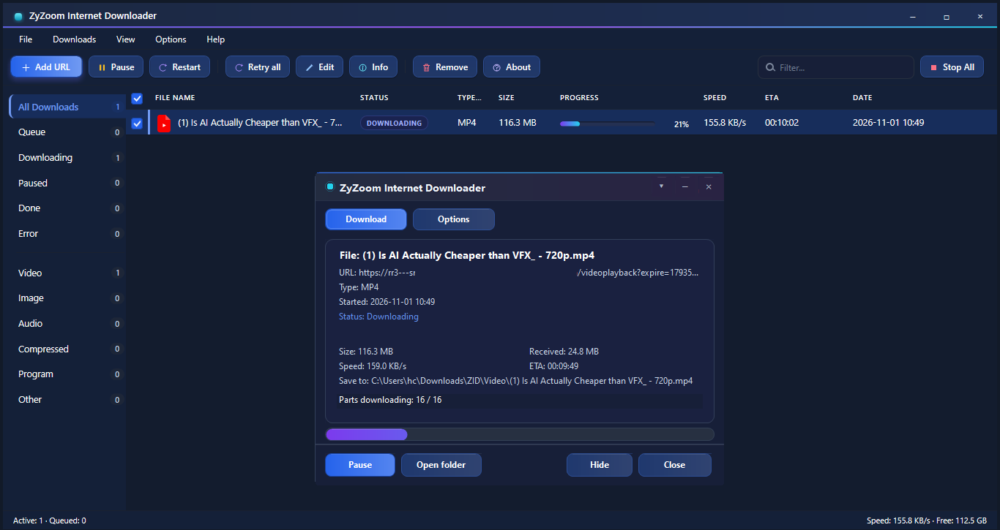

# ZyZoom Internet Downloader (ZID)

<p align="center">
  <a href="#english"></a>
  <a href="#français"></a>
  <a href="#العربية"></a>
</p>

<p align="center">
  
</p>

<p align="center">
  <a href="https://github.com/youcef07dz/ZID/raw/main/dist/setup_1.0.exe">
    
  </a>
  &nbsp;
  <a href="https://github.com/youcef07dz/ZID/raw/main/dist/zid-firefox-1.0.xpi">
    
  </a>
</p>

---

<details name="zid-lang" open>
<summary><b>🇬🇧 English</b></summary>

## English

A fast, lightweight download manager for Windows 7 SP1+ with a browser hand-off, a queue, retry/recovery and a trilingual UI.

### What is ZID?

ZyZoom Internet Downloader is a small native Windows download manager. It drives **aria2** in the background, keeps a queue, survives crashes and network drops, and takes links from Chrome, Chrome 109, Firefox or the clipboard.

### Install

1. Download **[setup_1.0.exe](https://github.com/youcef07dz/ZID/raw/main/dist/setup_1.0.exe)**.
2. Run it (Windows 7 SP1 or newer, administrator).
3. Start **ZyZoom Internet Downloader** from the Start menu or the desktop shortcut.

The installer also copies the browser extensions (including `zid-firefox-1.0.xpi`) to the app folder and registers the `zid://` protocol.

### Features

- Multi-connection downloads through aria2 with pause, resume and stop.
- Queue, concurrency limit, scheduler and "when finished" actions (dialog, open file/folder, shut down).
- Crash-safe state: atomic saves, backup file, recovery after a kill or power loss.
- Automatic retry with backoff, network monitor and resume when the connection returns.
- Metadata probe before adding (size, type, name), duplicate handling and history.
- Browser hand-off over `ws://127.0.0.1:10007`; "Take over browser downloads" is on by default and can be turned off in the panel.
- Video/audio detection, subtitle pairing and MP4 merging with the bundled `mp4mux`.
- 20 UI languages, light/dark theme, accent colour, tray mode and taskbar progress.
- IE8-safe HTML UI, no external dependencies at runtime.

### Browser extensions

| Browser | Folder | Install |
|---|---|---|
| Chrome / Edge (MV3) | `zid-crx` | `chrome://extensions` → Developer mode → Load unpacked |
| Chrome 109 / Windows 7 (MV2) | `zid-crx109` | Same as above |
| Firefox | `zid-xpi` | `about:debugging` → Load Temporary Add-on, or install the bundled `zid-firefox-1.0.xpi` from the app folder (unsigned builds need Developer Edition / temporary loading) |

### Build from source

Requirements: .NET Framework 2.0 compiler (`csc.exe` 2.0.50727), Inno Setup 5.6.1 (installer only).

```bat
build.cmd        :: compiles bin\Release\ZID.exe
tests.cmd        :: builds and runs 296 tests
make-setup.cmd   :: creates the installer in bin\
```

### Notes

- Data: `%APPDATA%\ZID` (installed) or `data/` next to the exe (portable); downloads in `%USERPROFILE%\Downloads\ZID`.
- The Firefox XPI is unsigned. Release Firefox blocks unsigned add-ons; use Firefox Developer Edition, `about:debugging`, or the bundled `zid-xpi` folder.

</details>

<details name="zid-lang">
<summary><b>🇫🇷 Français</b></summary>

## Français

Un gestionnaire de téléchargements rapide et léger pour Windows 7 SP1+, avec passerelle navigateur, file d'attente, reprise après incident et interface trilingue.

### Qu'est-ce que ZID ?

ZyZoom Internet Downloader est un gestionnaire de téléchargements natif pour Windows. Il utilise **aria2** en arrière-plan, gère une file d'attente, résiste aux coupures réseau et aux arrêts brutaux, et récupère les liens depuis Chrome, Chrome 109, Firefox ou le presse-papiers.

### Installation

1. Téléchargez **[setup_1.0.exe](https://github.com/youcef07dz/ZID/raw/main/dist/setup_1.0.exe)**.
2. Lancez-le (Windows 7 SP1 ou plus récent, droits administrateur).
3. Ouvrez **ZyZoom Internet Downloader** depuis le menu Démarrer ou le raccourci du bureau.

L'installateur copie aussi les extensions (dont `zid-firefox-1.0.xpi`) dans le dossier de l'application et enregistre le protocole `zid://`.

### Fonctionnalités

- Téléchargements multi-connexions via aria2 : pause, reprise, arrêt.
- File d'attente, limite de téléchargements simultanés, planificateur et actions de fin (fenêtre, ouvrir le fichier/dossier, éteindre le PC).
- État résistant aux plantages : sauvegardes atomiques, fichier de secours, reprise après un arrêt forcé ou une coupure de courant.
- Nouvelle tentative automatique, surveillance du réseau et reprise au retour de la connexion.
- Analyse des métadonnées (taille, type, nom), gestion des doublons et historique.
- Passerelle navigateur via `ws://127.0.0.1:10007` ; « Prendre en charge les téléchargements du navigateur » est activé par défaut et désactivable dans le panneau.
- Détection vidéo/audio, sous-titres et fusion MP4 avec `mp4mux`.
- 20 langues, thème clair/sombre, couleur d'accent, mode barre d'état et progression dans la barre des tâches.
- Interface HTML compatible IE8, aucune dépendance externe à l'exécution.

### Extensions

| Navigateur | Dossier | Installation |
|---|---|---|
| Chrome / Edge (MV3) | `zid-crx` | `chrome://extensions` → Mode développeur → Charger l'extension non empaquetée |
| Chrome 109 / Windows 7 (MV2) | `zid-crx109` | Idem |
| Firefox | `zid-xpi` | `about:debugging` → Charger un module temporaire, ou installez le `zid-firefox-1.0.xpi` fourni dans le dossier de l'application (les modules non signés nécessitent Developer Edition ou un chargement temporaire) |

### Compiler

Prérequis : compilateur .NET Framework 2.0 (`csc.exe` 2.0.50727), Inno Setup 5.6.1 (installateur uniquement).

```bat
build.cmd        :: compile bin\Release\ZID.exe
tests.cmd        :: compile et lance les 296 tests
make-setup.cmd   :: crée l'installateur dans bin\
```

### Remarques

- Données : `%APPDATA%\ZID` (installé) ou `data/` à côté de l'exe (portable) ; téléchargements dans `%USERPROFILE%\Downloads\ZID`.
- L'XPI Firefox n'est pas signé. Firefox bloque les modules non signés : utilisez Developer Edition, `about:debugging` ou le dossier `zid-xpi` fourni.

</details>

<details name="zid-lang">
<summary><b>🇸🇦 العربية</b></summary>

<div dir="rtl">

## العربية

مدير تنزيلات سريع وخفيف لنظام Windows 7 SP1+ مع جسر مع المتصفح، قائمة انتظار، استعادة بعد الأعطال، وواجهة بثلاث لغات.

### ما هو ZID؟

ZyZoom Internet Downloader مدير تنزيلات أصلي لنظام ويندوز. يشغّل **aria2** في الخلفية، ويدير قائمة انتظار، ويستعيد التنزيلات بعد الأعطال وانقطاع الشبكة، ويستقبل الروابط من Chrome وChrome 109 وFirefox أو من الحافظة.

### التثبيت

1. نزّل **[setup_1.0.exe](https://github.com/youcef07dz/ZID/raw/main/dist/setup_1.0.exe)**.
2. شغّله (يتطلب Windows 7 SP1 أو أحدث وصلاحيات المسؤول).
3. افتح **ZyZoom Internet Downloader** من قائمة ابدأ أو من اختصار سطح المكتب.

ينسخ المثبّت أيضًا إضافات المتصفح (بما فيها `zid-firefox-1.0.xpi`) إلى مجلد التطبيق ويسجّل بروتوكول `zid://`.

### الميزات

- تنزيلات متعددة الاتصالات عبر aria2 مع الإيقاف المؤقت والاستئناف والإلغاء.
- قائمة انتظار، حد للتنزيلات المتزامنة، جدولة، وإجراءات عند الانتهاء (نافذة، فتح الملف/المجلد، إيقاف تشغيل الجهاز).
- حالة محصّنة ضد الأعطال: حفظ ذرّي، نسخة احتياطية، واستعادة بعد الإغلاق القسري أو انقطاع الكهرباء.
- إعادة محاولة تلقائية، مراقبة الشبكة، واستئناف عند عودة الاتصال.
- فحص بيانات الرابط (الحجم والنوع والاسم)، معالجة التكرار والسجل.
- جسر مع المتصفح عبر `ws://127.0.0.1:10007`؛ خيار «الاستيلاء على تنزيلات المتصفح» مفعّل افتراضيًا ويمكن إيقافه من اللوحة.
- كشف الفيديو والصوت، إقران الترجمة، ودمج MP4 عبر `mp4mux`.
- 20 لغة، سمة فاتحة/داكنة، لون تمييز، وضع شريط النظام، وتقدّم في شريط المهام.
- واجهة HTML متوافقة مع IE8، بدون أي تبعيات خارجية أثناء التشغيل.

### إضافات المتصفح

| المتصفح | المجلد | التثبيت |
|---|---|---|
| Chrome / Edge (MV3) | `zid-crx` | `chrome://extensions` ← وضع المطور ← تحميل إضافة غير محزومة |
| Chrome 109 / ويندوز 7 (MV2) | `zid-crx109` | كما سبق |
| Firefox | `zid-xpi` | `about:debugging` ← تحميل إضافة مؤقتة، أو ثبّت `zid-firefox-1.0.xpi` المرفق في مجلد التطبيق (الإضافات غير الموقّعة تحتاج Developer Edition أو تحميلًا مؤقتًا) |

### البناء من المصدر

المتطلبات: مترجم .NET Framework 2.0 ‏(`csc.exe` 2.0.50727)، وInno Setup 5.6.1 للمثبّت فقط.

```bat
build.cmd        :: يبني bin\Release\ZID.exe
tests.cmd        :: يبني ويشغّل 296 اختبارًا
make-setup.cmd   :: ينشئ المثبّت في bin\
```

### ملاحظات

- البيانات: `%APPDATA%\ZID` (عند التثبيت) أو `data/` بجوار الملف التنفيذي (نسخة محمولة)؛ التنزيلات في `%USERPROFILE%\Downloads\ZID`.
- ملف XPI غير موقّع. يمنع Firefox الإضافات غير الموقّعة: استخدم Developer Edition أو `about:debugging` أو مجلد `zid-xpi` المرفق.

</div>
</details>

---

<p align="center"><sub>ZyZoom Internet Downloader 1.0 · Windows 7 SP1+ · C# 2.0 / .NET 2.0</sub></p>
